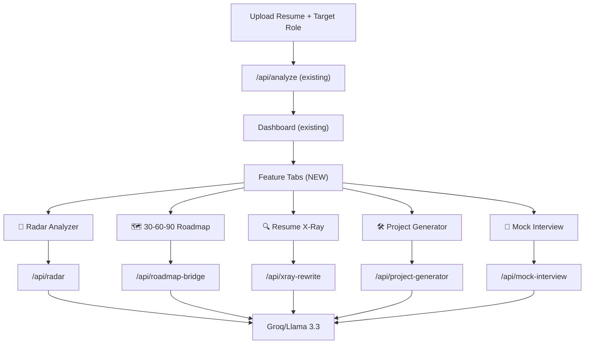

# Add 5 Advanced Features to Career Compass AI

The current app is a single-flow resume analyzer: upload resume → call Groq API → render a dashboard with scores, skills, roadmap, ATS tips, career paths, and improvements. We will add **5 new interactive feature modules** that appear as **tabbed panels below the existing dashboard**, each powered by a dedicated backend API endpoint + Groq prompt.

## Architecture Overview



---

## Feature Descriptions

### 1. 🎯 Multi-Axis Job-Fit Radar Analyzer
A rich, interactive **radar/spider chart** with 8–10 axes (Technical Skills, Soft Skills, Domain Knowledge, Tools & Frameworks, Certifications, Industry Experience, Leadership, Communication, Culture Fit, Innovation). Each axis scored 0–100 for both the candidate and the target role. Users can **click on any axis** to drill down into sub-skills with a detail panel.

### 2. 🗺️ Interactive 30-60-90 Day Skill Bridge Roadmap
A visually stunning **3-phase timeline** (30 / 60 / 90 days) with clickable milestone cards. Each milestone shows: skill to acquire, specific actions, resources, and a "Mark Complete" checkbox (saved in `localStorage`). Includes a **progress ring** showing overall completion %.

### 3. 🔍 Resume "X-Ray" (XYZ Bullet Point Rewriter)
Takes the user's existing resume bullet points, identifies weak ones, and rewrites them using the **X-Y-Z formula**: "Accomplished [X] as measured by [Y], by doing [Z]." Displayed as a **before/after card layout** with copy-to-clipboard on each rewritten bullet. Users can click "Regenerate" on individual bullets.

### 4. 🛠️ Tailored Proof-of-Work Project Generator
Generates **3–5 portfolio project ideas** specifically tailored to the target role + the candidate's skill gaps. Each project card includes: title, description, tech stack, difficulty level, estimated duration, learning outcomes, and a **step-by-step build guide**. Expandable/collapsible accordion cards.

### 5. 🎤 Rapid-Fire Mock Interview Simulator
A **conversational interview UI** where the AI asks role-specific interview questions one at a time. The user types their answer, gets instant AI feedback (strengths, improvements, score 1-10), and proceeds to the next question. Includes a **session summary** at the end with overall performance score. Supports 5–10 questions per session.

---

## Proposed Changes

### Backend — Prompt Utilities

#### [NEW] [radarPrompt.js](file:///e:/projectspblic/clg-miniproject/career-compass-AI/utils/radarPrompt.js)
Builds the system/user prompt for the Multi-Axis Radar feature. Returns JSON with 8–10 axes, each containing `axis`, `candidateScore`, `targetScore`, and `subSkills[]`.

#### [NEW] [roadmapBridgePrompt.js](file:///e:/projectspblic/clg-miniproject/career-compass-AI/utils/roadmapBridgePrompt.js)
Builds the prompt for the 30-60-90 Day Roadmap. Returns JSON with three phases, each containing milestones with `skill`, `actions[]`, `resources[]`, and `successMetric`.

#### [NEW] [xrayPrompt.js](file:///e:/projectspblic/clg-miniproject/career-compass-AI/utils/xrayPrompt.js)
Builds the prompt for the Resume X-Ray. Extracts bullet points from the resume and returns JSON with `bullets[]` each having `original`, `rewritten`, `score`, and `feedback`.

#### [NEW] [projectGenPrompt.js](file:///e:/projectspblic/clg-miniproject/career-compass-AI/utils/projectGenPrompt.js)
Builds the prompt for the Project Generator. Returns JSON with 3–5 projects, each with `title`, `description`, `techStack[]`, `difficulty`, `duration`, `learningOutcomes[]`, and `buildGuide[]`.

#### [NEW] [interviewPrompt.js](file:///e:/projectspblic/clg-miniproject/career-compass-AI/utils/interviewPrompt.js)
Builds two prompts: one for generating interview questions, another for evaluating answers. Question prompt returns `questions[]`. Answer evaluation returns `score`, `strengths[]`, `improvements[]`, and `sampleAnswer`.

---

### Backend — API Routes

#### [NEW] [features.js](file:///e:/projectspblic/clg-miniproject/career-compass-AI/routes/features.js)
A new Express router with 5 endpoints. All endpoints accept `resumeText`, `targetRole`, and `jobDescription` in the POST body (no file upload — the text is stored client-side after the initial analysis):

| Endpoint | Method | Body | Returns |
|---|---|---|---|
| `/api/features/radar` | POST | `{ resumeText, targetRole, jobDescription }` | Radar axes data |
| `/api/features/roadmap-bridge` | POST | `{ resumeText, targetRole, jobDescription }` | 30-60-90 roadmap |
| `/api/features/xray-rewrite` | POST | `{ resumeText, targetRole }` | Rewritten bullets |
| `/api/features/project-generator` | POST | `{ resumeText, targetRole, missingSkills }` | Project ideas |
| `/api/features/mock-interview` | POST | `{ resumeText, targetRole, action, questionIndex, userAnswer, questions }` | Questions or evaluation |

> [!IMPORTANT]
> All new endpoints receive **plain text** (not file uploads). The resume text extracted during the initial `/api/analyze` call is cached in the client's memory and sent along with subsequent feature requests. This avoids redundant file uploads and re-extraction.

#### [MODIFY] [server.js](file:///e:/projectspblic/clg-miniproject/career-compass-AI/server.js)
- Import and mount the new `featuresRouter` at `/api/features`.

#### [MODIFY] [analyze.js](file:///e:/projectspblic/clg-miniproject/career-compass-AI/routes/analyze.js)
- Return `resumeText` in the response so the client can cache it for subsequent feature API calls.

---

### Frontend — HTML

#### [MODIFY] [index.html](file:///e:/projectspblic/clg-miniproject/career-compass-AI/public/index.html)
Add a **tabbed feature panel** section inside `#dashboardSection`, after the existing improvements card. Structure:

```html
<!-- Feature Tabs -->
<div class="feature-tabs glass-card" id="featureTabs">
  <div class="feature-tabs__header">
    <button class="feature-tab active" data-tab="radar">🎯 Job-Fit Radar</button>
    <button class="feature-tab" data-tab="roadmap-bridge">🗺️ 30-60-90 Plan</button>
    <button class="feature-tab" data-tab="xray">🔍 Resume X-Ray</button>
    <button class="feature-tab" data-tab="projects">🛠️ Project Ideas</button>
    <button class="feature-tab" data-tab="interview">🎤 Mock Interview</button>
  </div>
  <div class="feature-tabs__content" id="featureContent">
    <!-- Dynamic content rendered by JS -->
  </div>
</div>
```

Also update the features grid on the upload page to reflect the 5 new features.

---

### Frontend — JavaScript

#### [NEW] [featureTabs.js](file:///e:/projectspblic/clg-miniproject/career-compass-AI/public/js/featureTabs.js)
Tab switching logic. Manages which feature panel is visible. Lazy-loads each feature's data on first tab click (calls the corresponding API). Caches results to avoid re-fetching.

#### [NEW] [radarAnalyzer.js](file:///e:/projectspblic/clg-miniproject/career-compass-AI/public/js/radarAnalyzer.js)
- Renders the multi-axis radar chart using Chart.js (8-10 axes).
- Clickable axis labels → opens a detail panel showing sub-skills with mini progress bars.
- "Generate Analysis" button triggers `/api/features/radar`.

#### [NEW] [roadmapBridge.js](file:///e:/projectspblic/clg-miniproject/career-compass-AI/public/js/roadmapBridge.js)
- Renders the 30-60-90 day interactive timeline.
- Each milestone is a clickable card with expand/collapse.
- "Mark Complete" checkboxes persist in `localStorage`.
- Animated progress ring at the top.

#### [NEW] [xrayRewriter.js](file:///e:/projectspblic/clg-miniproject/career-compass-AI/public/js/xrayRewriter.js)
- Before/after card layout for each bullet.
- Color-coded score badge (red/yellow/green) on original bullets.
- "Copy" button on each rewritten bullet.
- "Regenerate" button per bullet (re-calls API for that single bullet).

#### [NEW] [projectGenerator.js](file:///e:/projectspblic/clg-miniproject/career-compass-AI/public/js/projectGenerator.js)
- Accordion-style project cards.
- Each card shows: title, description, tech stack tags, difficulty badge, duration, learning outcomes, and a collapsible step-by-step build guide.
- "Generate More" button to get additional projects.

#### [NEW] [mockInterview.js](file:///e:/projectspblic/clg-miniproject/career-compass-AI/public/js/mockInterview.js)
- Chat-style UI with question bubbles and answer input.
- Flow: "Start Interview" → AI asks Q1 → User types answer → Submit → AI evaluates → Shows feedback → "Next Question" → ... → After all questions → Shows session summary with overall score.
- Progress indicator (Q 1/10).
- Session summary card at end with radar-style performance breakdown.

#### [MODIFY] [dashboard.js](file:///e:/projectspblic/clg-miniproject/career-compass-AI/public/js/dashboard.js)
- After rendering existing dashboard data, initialize the feature tabs.
- Pass `resumeText`, `targetRole`, and `jobDescription` to the `FeatureTabs` module.

#### [MODIFY] [upload.js](file:///e:/projectspblic/clg-miniproject/career-compass-AI/public/js/upload.js)
- Cache the `resumeText` returned from `/api/analyze` response.
- Pass it to `Dashboard.render()`.

#### [MODIFY] [app.js](file:///e:/projectspblic/clg-miniproject/career-compass-AI/public/js/app.js)
- Register the new sections.
- Clear feature tab caches on "New Analysis".

---

### Frontend — CSS

#### [MODIFY] [style.css](file:///e:/projectspblic/clg-miniproject/career-compass-AI/public/css/style.css)
Add styles for all new components, following the existing "Cosmic Navigator" dark glassmorphism design system:

- **Feature Tabs**: Horizontal scrollable tabs with glowing active indicator, smooth transitions.
- **Radar Analyzer**: Drill-down panel with sliding animation, sub-skill progress bars.
- **30-60-90 Roadmap**: Three-column layout (responsive → stacks vertically), milestone cards with hover effects, animated progress ring, checkbox states.
- **Resume X-Ray**: Before/after split cards with diff-style coloring, score badges, smooth rewrite animation.
- **Project Generator**: Accordion cards with gradient headers, tech stack pill tags, difficulty badges, collapsible build guides.
- **Mock Interview**: Chat bubble UI with alternating styles, typing animation, score display, session summary card.

---

## Open Questions

> [!IMPORTANT]
> **Rate Limiting**: Each feature tab makes a separate Groq API call. Groq's free tier allows ~30 requests/min. Should we add a cooldown timer between feature requests, or batch multiple features into a single prompt? Batching would be faster but the response quality may suffer from the large prompt size.

> [!NOTE]
> **Mock Interview Session Length**: Currently planned for 5–10 questions. Each Q&A cycle requires one API call (evaluation). That means a full session could use 10+ API calls. Should we reduce to 5 questions max, or do batch evaluation (user answers all, then gets feedback)?

---

## Verification Plan

### Manual Verification
1. Start the dev server (`npm run dev`).
2. Upload a sample resume and run analysis — verify existing dashboard still works.
3. Click each feature tab — verify lazy loading, API calls, and rendering.
4. Test Radar Analyzer: verify 8+ axes, click axis for drill-down.
5. Test 30-60-90 Roadmap: verify 3 phases, "Mark Complete" persists after page refresh.
6. Test Resume X-Ray: verify before/after cards, copy, regenerate.
7. Test Project Generator: verify accordion expand/collapse, tech stack tags.
8. Test Mock Interview: complete a full session, verify feedback per question and session summary.
9. Test responsive design on mobile viewport (Chrome DevTools).
10. Verify "New Analysis" resets all feature tabs and cached data.
